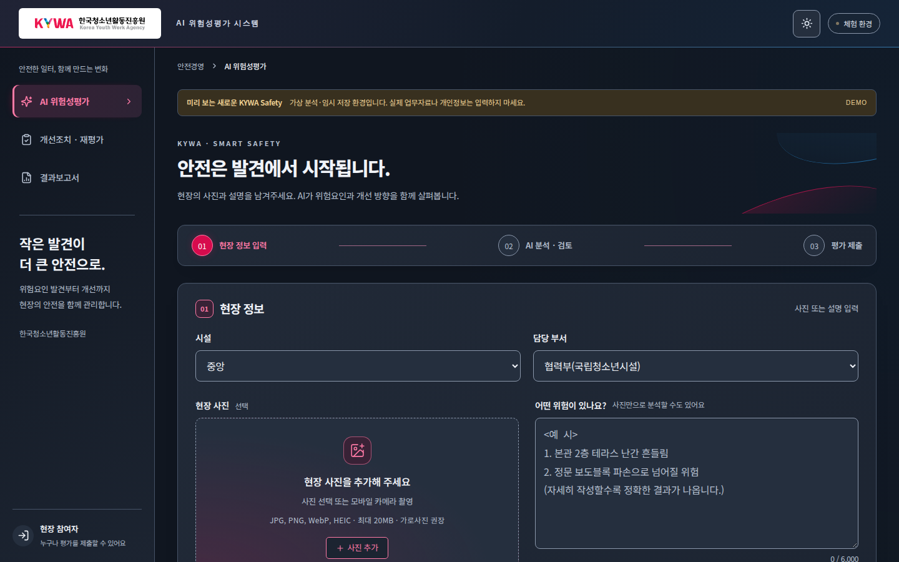

# 2026-11-03 디자인 보정 및 AYF 시설 중심 전환

이번 변경은 아래 11월 2일 디자인 기록을 보완한다. KYWA 상단은 흰 배경과 어두운 텍스트/테마 버튼/로그인 시계로 복원하고 공식 로고 이미지는 유지한다. 우측 곡선과 핑크·블루 배경 장식을 제거했다. 분석 버튼은 기존 전체 너비로 복원하고 KYWA의 활성 재평가 버튼만 붉은색으로 강조한다. 지원기관의 기존 분석 버튼 크기·기관색은 유지한다.

AYF는 부서·성명 필드와 관리자 필터·보고서 항목을 제거한다. 시설 11개만 선택하며 브랜드 노랑/분홍 및 나머지 레이아웃은 유지한다. 다른 기관은 기존 부서·성명 필수 설정을 유지한다.

로컬 전체 백엔드 267개 및 추가 AYF API 검사, 프런트 단위 15개/Next 빌드 통과. 검증 커밋 939dbe4의 GitHub CI 41568061328 verify/ax가 모두 통과했고 8개 Render 모두 Live다. 자동 반응형·테마 검사는 통과했으며 이번 CI 캡처의 별도 수동 육안 검토는 하지 않았다. 배포 증빙은 HANDOFF.md를 따른다. 배포 후 별도 앱 검증은 사용자 요청에 따라 생략한다.

---

# 2026-11-02 기관별 디자인 적용 기록

최종 디자인.txt 및 첨부 UI 콘셉트 이미지를 기준으로 구현했다. **최종 검증 후 8개 Render 서비스에 배포를 완료했다.** KYWA는 프리미엄 디자인, 나머지 7개는 기존 배치·크기·문구·배경을 유지하고 색상만 변경한다. 기존 AYF 연결/7개 기관 배포 완료와 이번 디자인 검증을 구분한다.

## 디자인과 색상

KYWA는 어두운 네이비 헤더와 차콜 카드, 핑크 활성 메뉴/번호/주요 버튼, 정적인 핑크·블루 곡선, 섬세한 카드 테두리와 입력 포커스를 적용한다. 기존 기능·입력 항목·필수값·개인정보 안내·메뉴 순서를 유지한다. 공식 로고 파일은 바꾸지 않는다. 현재 공식 파일의 흰 캔버스를 유지하는 작은 보호 영역을 두므로 참고 이미지의 어두운 로고 배경과는 이 부분이 다르다. 시안 이미지의 바깥 제목/컬러 견본은 실제 업무 화면에 추가하지 않는다.

7개 기관은 globals.css 원본을 그대로 사용한다. 공통 themes.css는 색상 속성만 바꾸며 헤더·사이드바·입력창·카드·문구·간격을 바꾸지 않는다. 보조색은 기존 통계 아이콘과 보고서 아이콘에 제한적으로 사용한다. 위험등급/경고/오류/성공, 기존 분류/시설 그래프 의미 색상은 유지한다.

| 기관 | 원본 메인 | 원본 서브 | 버튼 / 글자 | 다크 강조 | 라이트 강조 | 호버 |
|---|---|---|---|---|---|---|
| kywa | #F0145A | #2A8FD8 | #D70B4D / #FFFFFF | #FF7AA6 | #B90942 | #B90942 |
| fowi | #129F4A | #59C2E0 | #129F4A / #101418 | #38AE67 | #0E7F3B | #2AA95C |
| knps | #3B9F49 | #257ABA | #3B9F49 / #101418 | #58AD64 | #2E7C39 | #358F42 |
| khidi | #F2682A | #78777C | #F2682A / #101418 | #F3773F | #B64E20 | #DA5E26 |
| knf | #014099 | #E60012 | #014099 / #FFFFFF | #789AC9 | #014099 | #013A8A |
| kohi | #E24E2C | #F6A12B | #E24E2C / #101418 | #E9775D | #C24326 | #E56041 |
| cayf | #53805A | #E3B65C | #53805A / #FFFFFF | #80A185 | #4D7754 | #4B7351 |
| ayf | #FCD600 | #C81E86 | #FCD600 / #101418 | #FCD600 | #816D00 | #E3C100 |

원본 HEX는 `primary/secondary`에 유지한다. 보정값은 글자 대비 4.5:1 이상, 포커스·주요 버튼 경계 3:1 이상을 확보하도록 별도 역할값으로 계산한다. AYF의 노란 버튼은 어두운 글자, KNF의 파란 메뉴 강조는 밝은 파생색을 사용한다. KYWA 흰 버튼 글자를 위해 버튼 채움을 #D70B4D로 보정한다. 세부 보조색과 계산값은 artifacts/design-colors.json에 기록한다.

## 변경 파일과 격리 방식

- `backend/organizations/{kywa,fowi,knps,khidi,knf,kohi,cayf,ayf}.json`: primary, secondary, design만 변경.
- `backend/organization.py`: 공개 브랜드 설정 필드 추가. `backend/branding.py`: 대비 보정 역할색 계산.
- `backend/main.py`: 기존 bootstrap의 공개 브랜딩 응답에 secondary_colors만 추가. 평가·저장·인증 API 처리 로직은 변경하지 않음.
- `frontend/app/brand.tsx`: 공통 CSS 변수. `page.tsx`: 기관 설정에 따른 premium-app/data-design, KYWA 헤더 명칭/장식만 추가. 파트너 화면 콘텐츠 동일.
- `frontend/app/themes.css`: 공통 색상 전용. `premium.css`: KYWA 전용 화면 스타일. `layout.tsx`: 두 스타일 로딩.
- `backend/tests/test_design_tokens.py`, `frontend/tests/design.spec.ts`, `institution-branding.spec.ts`, `playwright.config.ts`, `deploy/ci.yml`: 색상·대비·3개 화면·PC/태블릿/모바일·파트너 크기 유지 검사. 실제 workflow는 .github/workflows/kywa-next-ci.yml.
- `AGENTS.md`, `HANDOFF.md`, `CHANGELOG.md`, 이 문서 및 공개 산출물: 배포 범위와 인수인계 갱신.

KYWA 활성화 조건은 기관 ID가 kywa이고 branding.design=premium인 경우다. 다른 기관은 설정에 premium을 잘못 지정해도 KYWA 전용 화면이 활성화되지 않는다. 기관 로딩 전에는 중립 색상을 사용한다. 새 패키지는 추가하지 않는다. 프린트 매체에는 화면 프리미엄 스타일을 적용하지 않는다.

## 검증 상태

- 로컬 Next 빌드·TypeScript, 프런트 단위 15개, 백엔드 전체 264개 검사 통과.
- 표준 globals.css는 AX 완료 커밋 4f9d6dc 대비 바이트 단위 동일. 8개 기관 설정의 branding 외 필드는 모두 동일. artifacts/design-scope-audit.json 참조.
- 전체 회귀 첫 실행에서 Windows 임시 파일 잠금 1회가 발생했고 해당 성명 테스트 재실행은 통과했다. 저장 로직은 이 디자인 작업에서 변경하지 않았다. 전체 264개를 별도 임시 폴더로 재실행하여 통과했으며, 최종 Linux CI 전체 회귀도 통과했다.
- [CI 41420384220](https://github.com/archi01-safety/kywa-safety-app/actions/runs/41420384220)에서 Linux 전체 회귀·Next 빌드·PC/태블릿/모바일·다크/라이트·8개 기관·root Docker와 AX 비root/읽기 전용/재시작 검사를 모두 통과했다. 검증 커밋은 eee38a37f4bcd072f02d5c9d5ce5be19810c7704이다.
- 화면 검증은 합성 자료를 사용했다. 기관별 데스크톱/모바일 캡처를 artifacts/design-기관-desktop.png 및 mobile.png에 보관하며, 이 캡처의 체험 환경 표시는 CI 시험 설정이다. 운영 환경변수·Google 시트/Drive·권한·AX 서버 설정은 디자인 작업에서 변경하지 않았다.

2026-11-02 후속 사용자 지시: 디자인 검증 통과 후 KYWA와 7개 기관 Render에 배포하고, 배포 상태만 확인한다. 별도의 배포 후 제출·사진·보고서 시험은 생략한다. AX 플랫폼 등록은 포함하지 않는다.

초기 디자인 CI의 5개 실패는 기존 흰 헤더 기대값과 보고서 화면에 없는 버튼을 찾던 테스트였다. 승인된 다크 헤더와 실제 활성 메뉴를 기준으로 수정 후 모두 통과했다. 업무 로직은 수정하지 않았다.

## 화면 근거

배포 전 CI의 합성 자료 화면이다. KYWA의 네이비/핑크·블루와 기관별 색상을 PC·태블릿·모바일에서 확인했다. 위 캡처의 체험 환경 배너는 운영 모드 전환을 의미하지 않는다.

## 배포 완료

2026-11-02 KYWA와 7개 지원기관을 검증 커밋 `eee38a37f4bcd072f02d5c9d5ce5be19810c7704`로 개별 수동 배포했다. 모든 서비스의 Render `Deploy succeeded / Live`를 확인했다. 기관별 배포 ID·이전 SHA는 artifacts/render-deployments.json에 기록했다. 사용자 요청에 따라 배포 후 별도 앱·제출·사진·보고서 검증은 생략했다. 무료 플랜·기존 환경변수·Google 저장소·공유 권한을 유지했고 주기 호출을 추가하지 않았다. AX 실제 등록은 이번 Render 배포에 포함하지 않는다.
